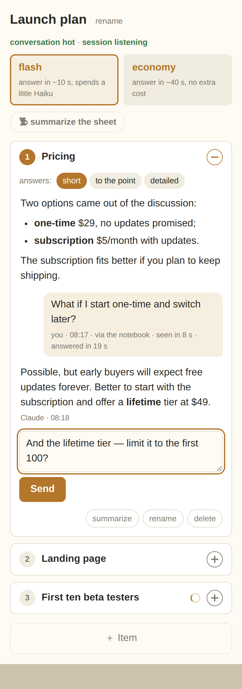

# Threadbook

Break long Claude Code answers into points you can discuss in any order — in the same session, from any device.

Claude lays the answer out as an interactive artifact — a private notebook page with one thread
per point. Walk away from the terminal, open the page on your phone, and write under whichever
point you like; the same session, with its full memory, replies right under it.



## Install

In Claude Code:

```
/plugin install threadbook --marketplace gvmatrosov/threadbook
```

or add the catalog once and install from it:

```
/plugin marketplace add gvmatrosov/tashi-solo
/plugin install threadbook@tashi-solo
```

**Claude Code only.** The notebook is answered by a session running in your terminal, so the
plugin is for Claude Code; it ships a small command (`bin/`), which keeps claude.ai chat and Cowork
from installing it. It needs Claude Code signed in to a claude.ai account with Artifacts available.
The page is a private claude.ai Artifact: it works opened at claude.ai (phone browser included),
not elsewhere.

## Use

After a long answer, say **"put this in a notebook"** (or «разложи в тетрадь»), or run
`/threadbook:notebook`. Claude splits the material into items — one per point or question —
publishes the page and hands you the link. Open it anywhere and write under any item. Up to 15
points it just lays them out; with more, it first asks whether to publish them all, condense
them, or drop some.

- **Each item is its own thread** with its own answer field. Items fold to a numbered list; a red
  dot marks a new answer, ✎ an unsent draft, a spinner a line still on its way.
- **Answer length per item**: short, to the point, or detailed.
- **Summarize**: mark items and press "summarize the sheet" — Claude writes two to five lines of
  conclusions into each, and the thread folds under them.
- **Add, rename, delete** items; rename the sheet. Drafts survive a reload.
- Claude's answers render Markdown. The page speaks English or Russian, following the language
  you talk to Claude in.

## How a line reaches the session

The session in your terminal must stay running — it is the one answering.

- **flash** (the default): for 5 minutes after the page is published, and for about 2.5 minutes
  after each answer, the conversation is "hot" and a small background agent on Haiku watches the
  page. A line written then is picked up in ~10–20 s. Once it cools, a line wakes the session
  through a claude.ai comment (~30–60 s).
- **economy**: comment wake-ups only — every line ~30–60 s, nothing extra spent.

Switch on the page at any time. If a line gets no reaction in 30 s, the page offers one tap to
wake the session again.

**What it costs:** every answered line is a turn of your main session and uses your plan like
any message. The Haiku watcher in flash adds about 1% on top (measured: a fraction of a cent per
line). claude.ai allows 60 comment wake-ups per page per hour; hot lines spend none.

## Limits, honestly

- **Discussion only.** A line from the page is something to answer, never a command to run: the
  session does not edit files, run anything that changes state, or send anything outward because
  the page asked. It says what it would do; you confirm in the terminal.
- **Summarize does not shrink the session's memory** — only `/compact` in the terminal does.
- One page = one session. Drafts are kept in the browser they were typed in.
- If the comment watch ends after hours of silence, the page says "session not listening"; tell
  the session "notebook, wake up" in the terminal.

## What it runs and sends

- **The notebook skill** tells your session to: copy the page files into its scratchpad folder,
  publish them as a private Artifact on claude.ai, write the items and its answers into that
  Artifact's database, and watch the Artifact's comments. It edits none of your files.
- **The page** runs in your browser at claude.ai and talks only to claude.ai: it saves your lines
  in the Artifact's database and, when the session needs waking, sends the line as a comment to
  Claude. That comment ends with a short note asking claude.ai's automatic comment reply to answer
  with one word ("received"), because the real answer comes from your session into the page.
  Drafts and which items are open stay in your browser's local storage.
- **The background agent** (`threadbook:poller`, flash mode only) runs on Haiku, reads the
  Artifact's database for new lines and runs `sleep 4` between reads — nothing else.
- **`threadbook-now`** (in `bin/`) prints the current time in milliseconds; the session uses it
  to stamp rows.

Nothing is sent anywhere but claude.ai. The plugin reads no credentials, keeps no data of its
own and has no telemetry; the notebook's content lives in your private Artifact until you delete it.

## Development

Plain ES modules and Markdown, no build step: what is in the repository is what runs.

## License

MIT
